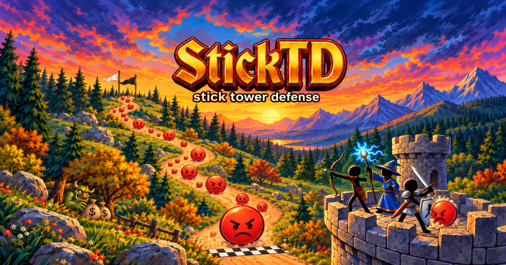

# StickTD

Stick Tower Defense

[**Play**](https://sauerninja.github.io/StickTD/) · [**Download**](https://github.com/SauerNinja/StickTD/releases/latest)

A small band of stick-figure defenders. One winding road. Whatever comes down it.

Raise a squad from humble beginnings, send it out to meet every wave, and watch your fighters become something worth remembering. Every battle sharpens a defender, every drop opens a new option, and the road keeps growing long after you think you have seen it all.

## Features

| | |
|---|---|
| **A band worth building** Swordsmen, archers, mages and a long roster of specialists, each with a job of their own. | **Fighters who grow** Every battle shapes who a defender becomes. Train their strengths and unlock new classes along the way. |
| **Fire, lightning and ice** Attune a fighter to an element, or blend two into something rarer. | **A road that grows** The map keeps unfolding, so the line you hold is never quite the same twice. |
| **Loot and the unexpected** Gear, food, treasure and passing travelers reward players who pay attention. | **Waves that escalate** Small scouts give way to heavy hitters, with a boss to close out each chapter. |

## The roster

| Branch | Classes |
|---|---|
| **Melee** | Swordsman, Axeman, Spearman, Hammerman, Paladin, Berserker, Lancer |
| **Ranged** | Archer, Marksman, Sniper, Blowdart, Blow Gunner, Dual Squirt Gun, Gatling, Crazy Chef |
| **Magic and support** | Mage, Snap Caster, Cleric, Pope, Necromancer |
| **Explosives and guns** | Bomber, Cowboy, Glaive |
| **Special** | Ninja, Cat Snapper, Merchant, Hacker |
| **Structures** | Barricade, Log Mill, Stone Quarry, Vault |

## Elements

Fire, lightning and ice answer to a fighter's training. Blend two and something rarer wakes up: **Proton**, **Dark Matter** and **Quasar**. They belong to the fighters who earn them, never to the build menu.

## Your pace, your way

A lone barricade stands watch at the finish when the first wave rolls in. From there, set the speed, choose your moment, and play on a phone or a computer with touch or mouse. Save a run to a file and pick it up whenever you like.

## Get the game

Play instantly in a browser, or install a build for Windows, macOS, Linux (Intel/AMD or ARM) or Android from the [Releases](https://github.com/SauerNinja/StickTD/releases/latest) page. Every download is published with checksums and a build attestation, so you can confirm exactly what you are running.

On iPhone or iPad, open the game in Safari, tap Share, then Add to Home Screen. It gets its own icon and fills the screen like an app.

## Run it locally

Serve the folder with any static server and open `index.html`, for example `python3 -m http.server`, then visit `http://localhost:8000`. Opening the file directly also works in most browsers. Run `python3 release.py check` before publishing to verify versions, script tags and the design contract.

## Project layout

| Path | Purpose |
|---|---|
| `index.html` | Page shell, styles and interface |
| `js/config.js` | Rendering, audio, blood, menus, saves and the design contract |
| `js/environment.js` | Map, road growth, biomes, scenery and items |
| `js/towers.js` | Stickman classes, targeting, projectiles and combat |
| `js/waves.js` | Enemies, wave plans, random events and livestock |
| `CHANGELOG.md` | Current-version release notes; older entries in `HISTORY.md` |
| `AGENTS.md` | Owner rules and the rule-ID ledger |

## Made with

HTML5 Canvas, plain JavaScript and the Web Audio API. Every picture is drawn by code and every sound and piece of music is synthesized in the browser. The game is plain scripts with no libraries, no build step and no image or audio files.

## License

MIT. See [LICENSE](LICENSE).
